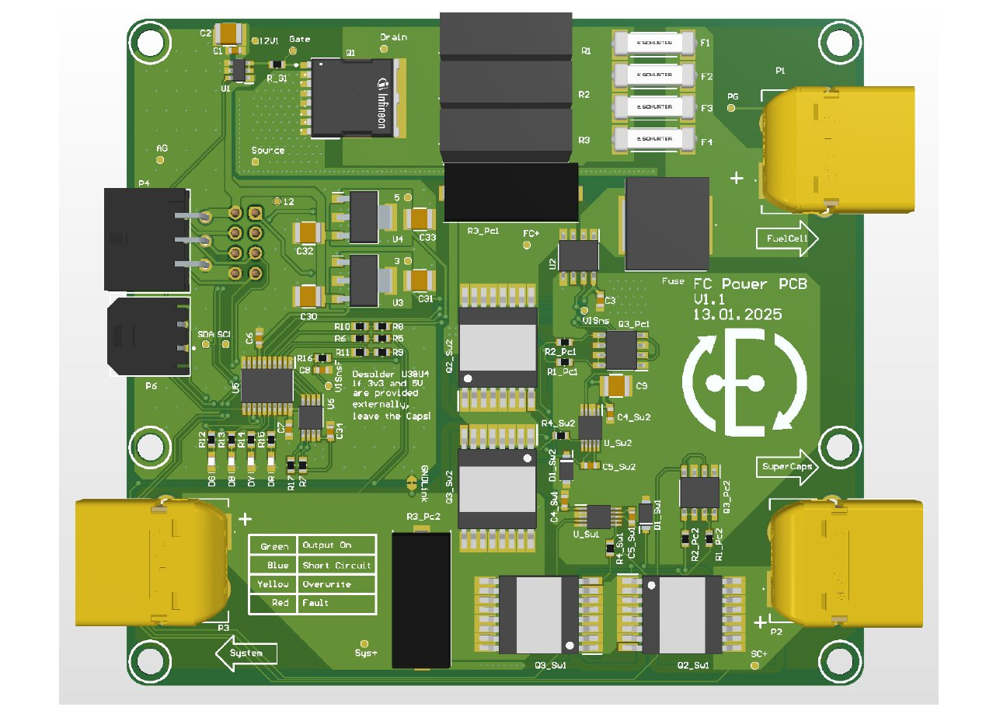
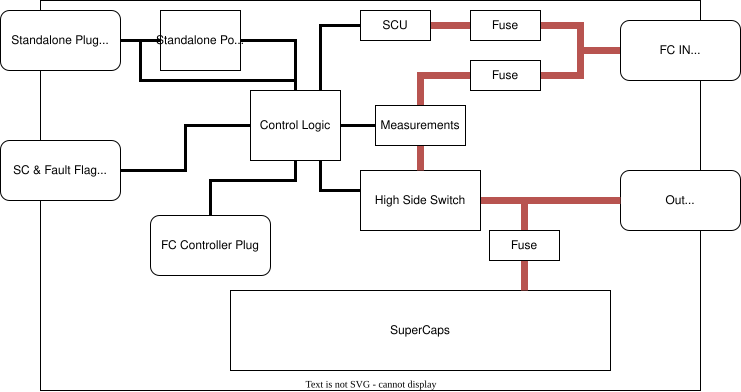
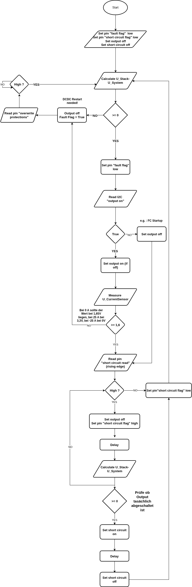
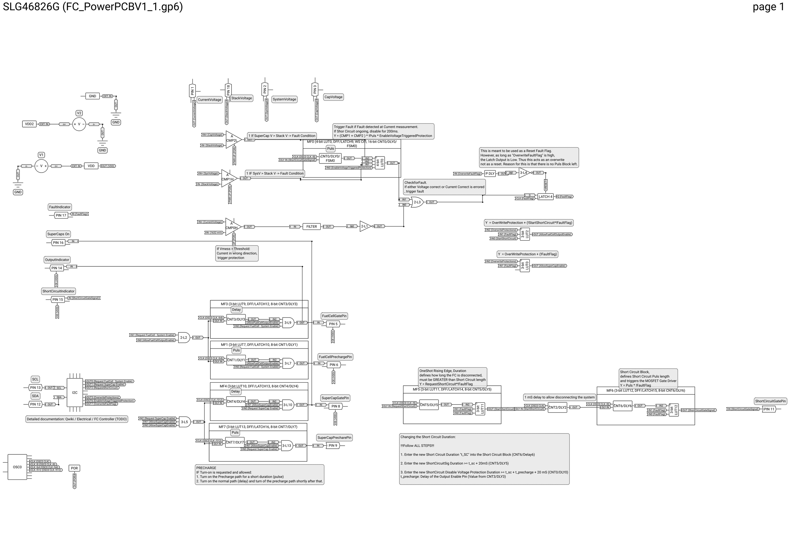
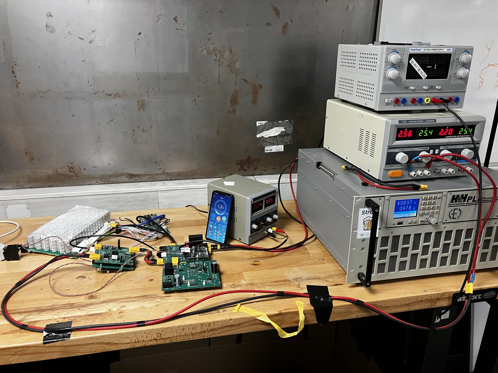
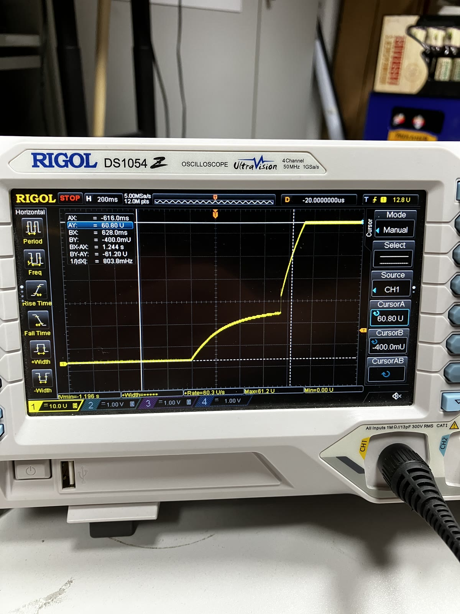

# Fuel Cell Power PCB

**Context:** Ecogenium student team (hydrogen vehicle, Shell Eco-marathon) · **Tools:** Altium Designer, Renesas GreenPAK Designer, draw.io
**Timeline:** V1.1, 01/2025
<!-- TODO: confirm/adjust your role -->
**My role:** Concept, schematic, layout, GreenPAK logic
**Documentation:** [Schematic & layout (PDF)](FC_PowerPCB.pdf)

## What it does

This board is the power stage between the **fuel cell stack**, a **supercapacitor buffer** and the
vehicle's **power system**. It switches and protects the power paths, measures them and can
short-circuit the stack on demand. All of this runs in hardware logic, so there is no
microcontroller in the critical path.

## Key features

- **High-side switches:** an on-board GreenPAK logic IC switches the fuel cell, the supercapacitor stack and the power system on or off on request. It only does so if none of the monitored safety conditions is active.
- **Precharge circuits** (PNP transistor + power resistors) on all paths, so capacitive loads are charged gently before the main MOSFETs close
- **Short-Circuit Unit (SCU):** a low-ohmic MOSFET branch that briefly shorts the stack, used to test whether short-circuit strategies improve the fuel cell's efficiency
- **Measurement:** ACS711 Hall current sensor (±25 A) and a MAX1237 I²C ADC for stack, system and supercap voltages
- **Interfaces:** I²C, fault flag and overwrite input to the FC controller; standalone 12 V supply with on-board 5 V / 3.3 V LDOs

## Control logic

The complete control logic runs in a **GreenPAK SLG46826**, a programmable mixed-signal IC with
comparators, LUTs, counters and an I²C interface:

- **Reverse-current protection:** comparators keep the output enabled only while U_Stack ≥ U_System and the current flows in the right direction
- **Precharge sequence:** when a path is switched on, the precharge path is pulsed first and the main MOSFET follows after a delay
- **Short-circuit sequence:** output off → stack shorted for a defined time → output back on; protections are masked only for the duration of the pulse
- **Fault latch** with status LEDs (output on / short circuit / overwrite / fault) and an overwrite input for testing

Flowchart of the control logic

 

GreenPAK implementation

 

## Testing

<table>
  <tr>
    <td></td>
    <td></td>
  </tr>
  <tr>
    <td><em>Bench test with lab power supplies and an electronic load</em></td>
    <td><em>Measured precharge of the output (10 V/div, 200 ms/div)</em></td>
  </tr>
</table>
