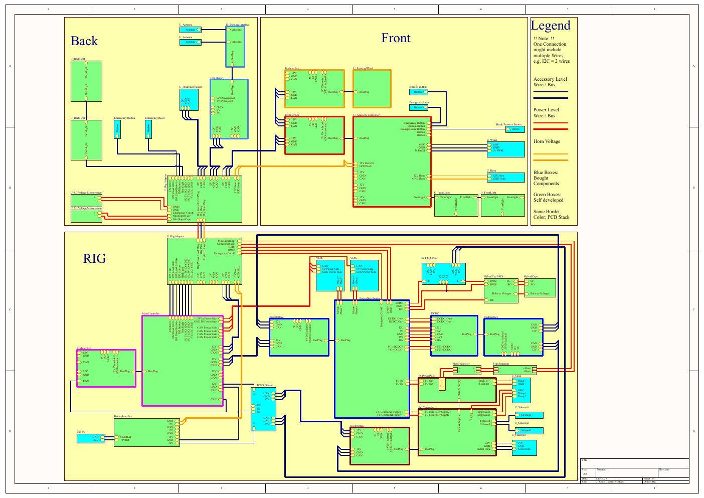
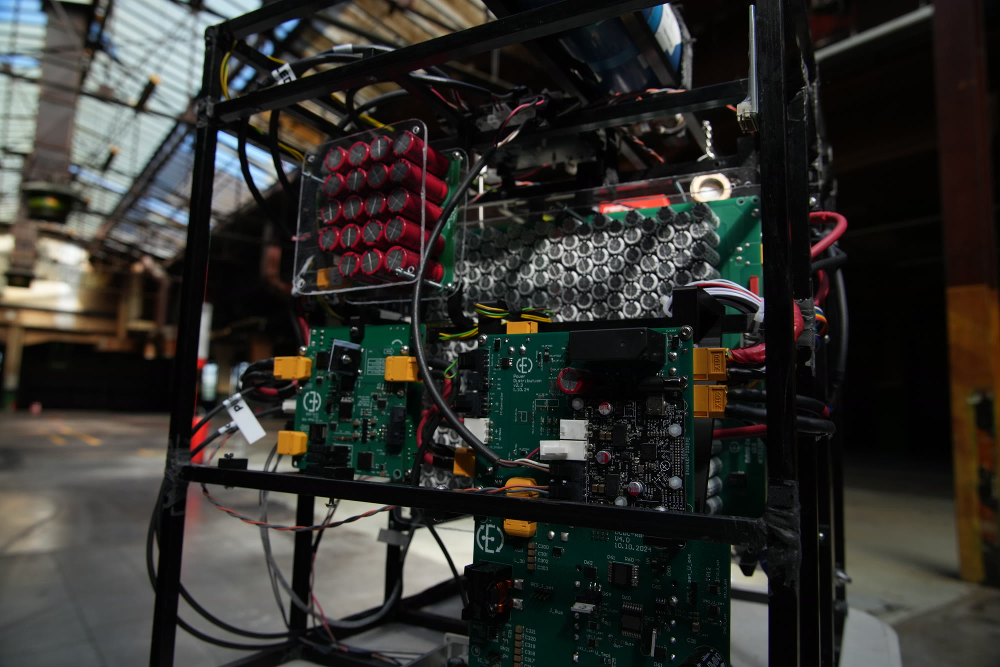

# Vehicle Electrical System Architecture

**Context:** Ecogenium student team (hydrogen vehicle, Shell Eco-marathon) · **Tools:** Altium Designer (as a drawing tool)
<!-- TODO: confirm/adjust your role and add the date -->
**My role:** System architecture of the vehicle's low-voltage electronics

## What it shows

A top-level architecture draft of the whole vehicle: which boards exist, where they sit and how
they are connected.

- **Three areas:** *Back*, *Front* and the central *RIG*, each with its own adapter or connection point
- **Self-developed boards (green):** Power Distribution, FC Power PCB, FC Controller, Main Controller, DC/DC, Battery Interface, Accessory Controller and the [Bus Interface](../01-BusInterface/) nodes stacked on most of them
- **Bought components (blue):** VESC motor controllers, IVT-S current/voltage sensors, hydrogen sensor, wireless interface, wiper, horn, lights, solenoids and mass-flow sensor
- **Three wire classes:** accessory level (CAN, I²C, 12 V), power level (fuel cell, supercaps, motors) and horn voltage

The draft defined the interfaces for the individual boards, e.g. the
[Power Distribution](../04-PowerDistribution/), the [FC Power PCB](../02-FuelCellPowerPCB/) and the [Bus Interface](../01-BusInterface/).

## In the vehicle

*The installed electronics: supercapacitor banks at the top, Power Distribution v2.3 with a Bus Interface in the middle, DC/DC converter below.*
