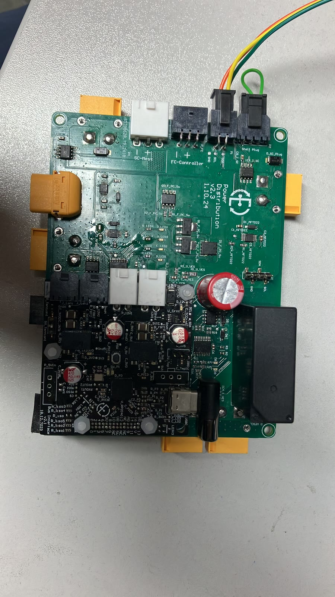
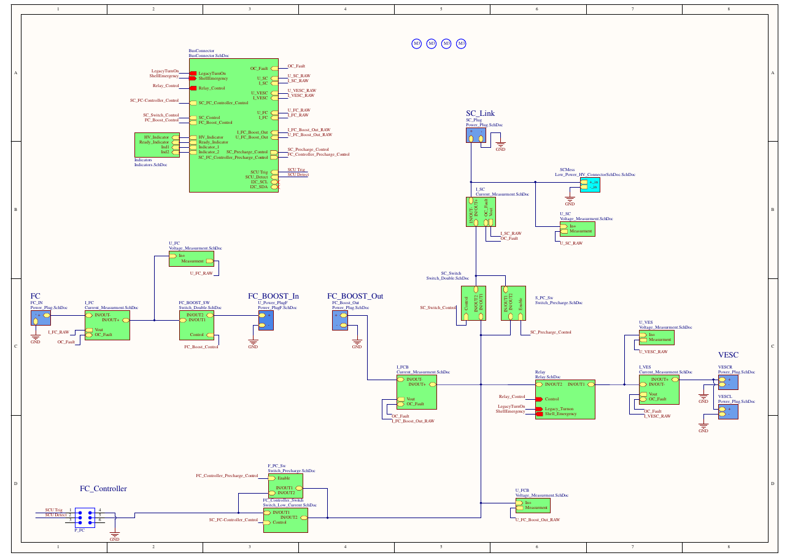

# Power Distribution Board (v2.3)

*Power Distribution v2.3 with a [Bus Interface](../01-BusInterface/) plugged on*

**Context:** Ecogenium student team (hydrogen vehicle, Shell Eco-marathon) · **Tools:** Altium Designer, Renesas GreenPAK Designer
**Timeline:** v2.3, 10/2024
**My role:** Further development from v2.2 to v2.3: precharge circuit and logic, control of the external DC/DC converter

## What it does

The central power hub of the vehicle's drivetrain. It connects the **fuel cell**, its **boost
converter**, the **supercapacitor bank** and the two **VESC motor controllers**. Every path can be
switched individually, and the board measures voltage and current on all of them.

## Key features

- **High-current switching** of every power path with MOSFETs and high-side gate drivers
- **Precharge** of large capacitive loads (motor controllers, supercaps) through dedicated precharge switches
- **Emergency shutoff relay** triggered by the Shell telemetry emergency input or via the bus
- **Measurement on all paths:** 4× ACS711 Hall current sensors (±25 A, with over-current fault outputs), voltage dividers and an LTC1867 16-bit ADC
- **Galvanic isolation** of the communication: ADuM1250 (I²C) and ADuM4152 (SPI)
- **Hardware logic:** 3× GreenPAK SLG46826 for MOSFET control, safety-relevant logic, indicators and DC/DC control

## My contribution

Up to v2.2, large capacitive loads were precharged by running the main MOSFETs in their linear
region. This worked, but put a lot of stress on the MOSFETs. After the original designer left the
team, I took over the board and:

- implemented a dedicated precharge circuit and its control logic
- added logic to control the external DC/DC converter
- added some quality-of-life functions for testing

The final design worked reliably.
