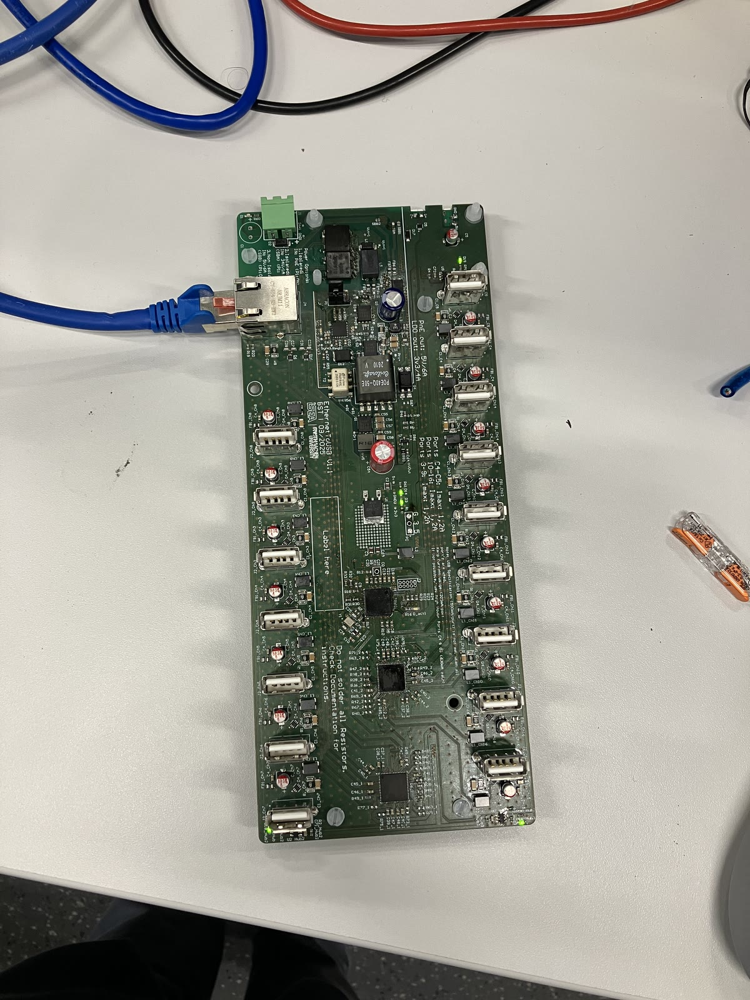

# Ethernet-to-USB Hub (16 ports, PoE)

*Prototype V1.1 in operation*

**Context:** Student assistant (HiWi) at ISEA, RWTH Aachen University · **Tools:** Altium Designer, FreeCAD
**Timeline:** V1.1 03/2025 → V1.2 09/2026
**My role:** Concept, schematic, layout

## What it does

A network-attached USB hub. It makes **16 USB-A ports** reachable over a single Ethernet cable,
which can also supply the power (**PoE**). A Raspberry Pi Zero on the board acts as the USB host.

## Architecture

- **Host:** Raspberry Pi Zero, connected via USB to a **Microchip LAN9514**, which provides 10/100 Ethernet and a 4-port USB 2.0 hub
- **Fan-out:** two cascaded **USB2517** 7-port hubs plus two direct ports, 16 downstream ports in total
- **Power over Ethernet:** Si3406x PD controller with class negotiation, inrush control and an isolated flyback converter for **5 V / 6 A**; alternatively an external 5 V supply. An input filter allows hot-plugging.
- **ganged-port protection:** current-limited power switches (about 1.2 A per port group) and ESD protection. Ganged due to two layer limitation.
- **3.3 V / 1 A** LDO for the logic
