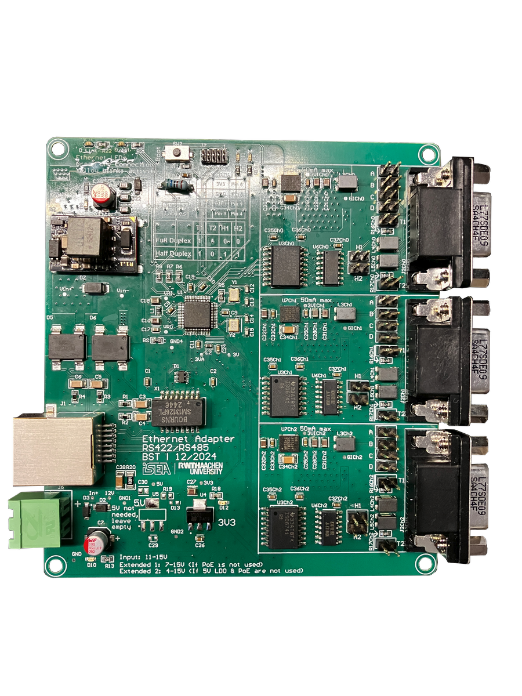

# Ethernet ↔ 3× Isolated RS422/RS485 Adapter

**Context:** Student assistant (HiWi) at ISEA, RWTH Aachen University · **Tools:** Altium Designer
**Timeline:** 12/2024 · **Status:** manufactured and assembled
**My role:** Concept, schematic, layout, assembly

## What it does

Connects **three independent serial devices** (RS422 or RS485) to the network via a single Ethernet
port. Every channel is **galvanically isolated**, so devices on different ground potentials can be
connected safely.

## Key features

- **3 serial channels**, designed once as an Altium multi-channel sheet. Each channel has:
  - ISO6741 digital isolator
  - isolated 1 W DC/DC converter (MIE1W0505) for the bus side (max. 50 mA per channel)
  - ISL83076E RS422/RS485 transceiver
  - jumpers for **full or half duplex** and termination
  - **configurable DB9 pinout** (jumpers A–D), covering e.g. the Sony RS422 and the Profibus RS485 pin assignments
- **Power:** 11–15 V input and an optional **PoE module** (AG9912); the input range extends down to 4 V if the PoE module and the 5 V LDO are not populated
