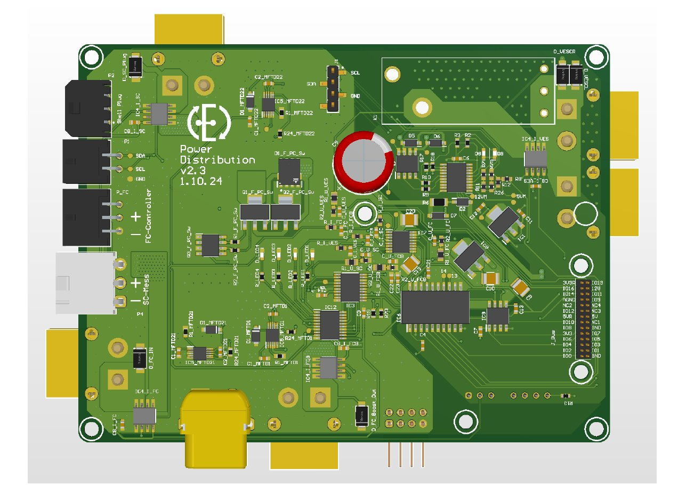
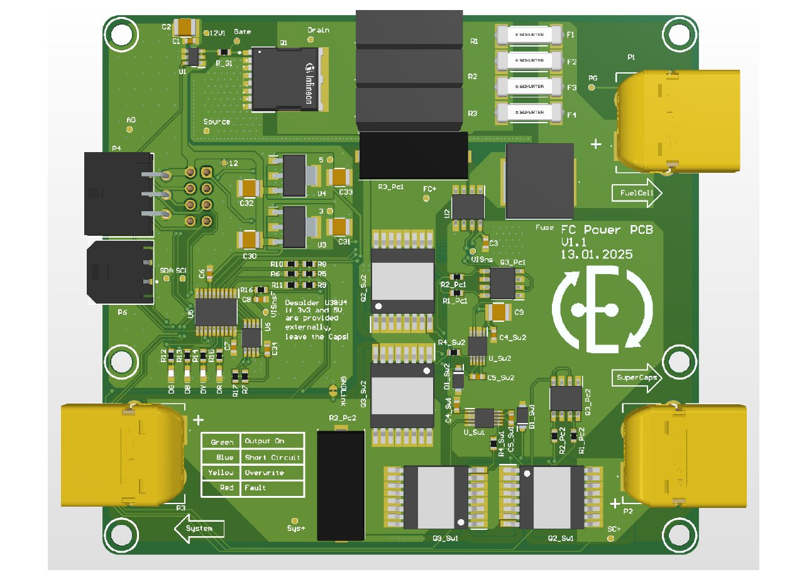
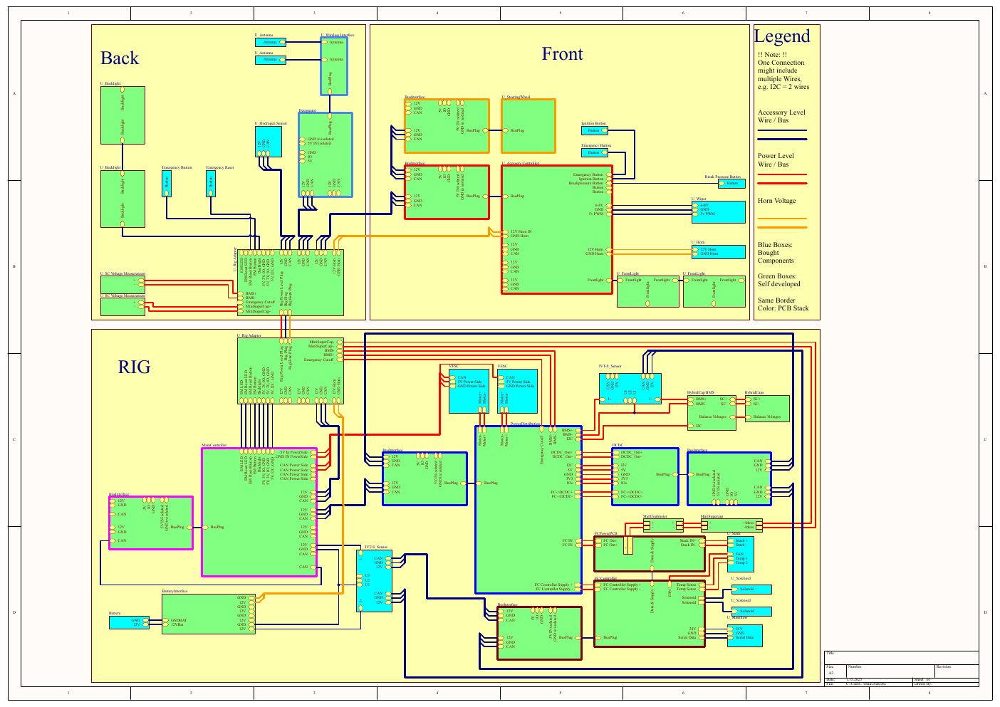
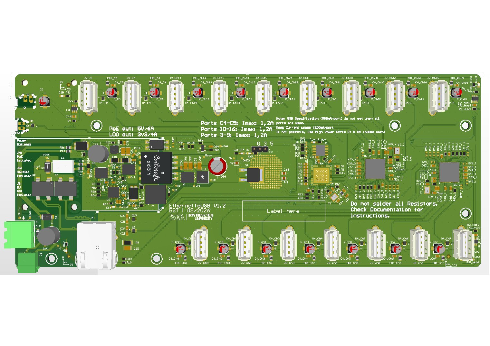
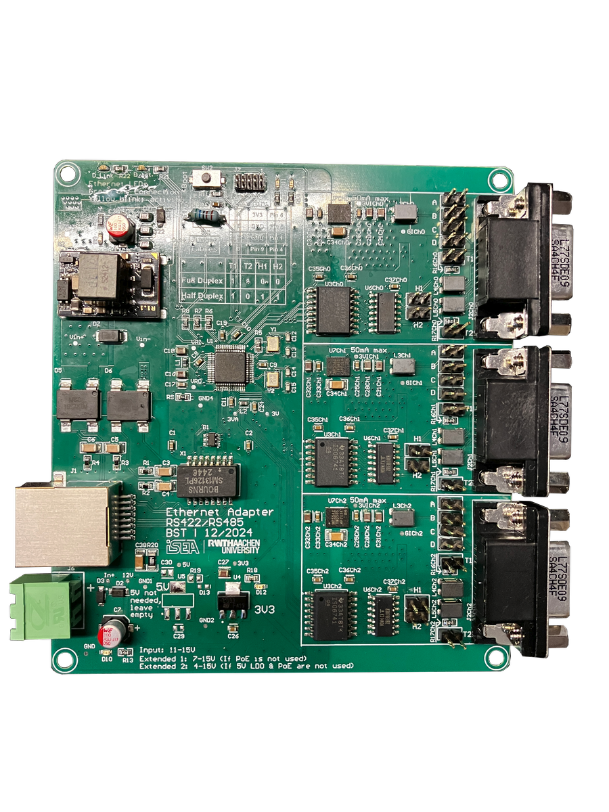

# Electronics Portfolio – Fabian

Electrical engineering student. This repository collects selected PCB and system designs from my
work in the student team **Ecogenium** (hydrogen fuel cell vehicle for the Shell Eco-marathon) and
my job as a **student assistant at ISEA, RWTH Aachen University**.
It shows part of my work during that time and is not a complete record; projects from my
internship are not included.

The projects range from controller nodes to power electronics and mixed-signal designs:
high-current MOSFET switching with precharge, hardware safety logic in GreenPAK ICs, CAN FD nodes,
PoE power supplies, USB hubs and isolated industrial interfaces.

**Tools:** Altium Designer · KiCad · Renesas GreenPAK Designer · draw.io · FreeCAD · Git

## Projects

| | Project | Summary |
|---|---|---|
|  | **[Power Distribution v2.3](Projects/04-PowerDistribution/)** *Ecogenium · 2024* | Further development of the central drivetrain power hub connecting fuel cell, boost converter, supercaps and motor controllers. Precharge, emergency relay, isolated measurement, GreenPAK safety logic. |
|  | **[Fuel Cell Power PCB](Projects/02-FuelCellPowerPCB/)** *Ecogenium · 2025* | Switching and protection of the fuel cell stack with precharge, a short-circuit unit and a GreenPAK state machine. Tested on the bench. |
|  | **[Bus Interface V1 → V2](Projects/01-BusInterface/)** *Ecogenium · 2022–2024* | Standard controller node of the vehicle. Evolved from a Pi Pico carrier (KiCad) to a compact chip-down RP2040 board with CAN FD (Altium). |
|  | **[Vehicle System Architecture](Projects/03-SystemLayout/)** *Ecogenium* | Top-level architecture of the vehicle's electronics: boards, bought components, power and communication wiring. |
|  | **[Ethernet-to-USB Hub](Projects/07-EthernetUSB/)** *ISEA, RWTH Aachen · 2025–2026* | 16-port USB hub reachable over Ethernet. Pi Zero host, LAN9514 + 2× USB2517, PoE flyback supply (5 V / 6 A), per-port current limiting. |
|  | **[Ethernet ↔ RS422/RS485 Adapter](Projects/08-EthernetSerial/)** *ISEA, RWTH Aachen · 2024* | Three galvanically isolated RS422/RS485 channels on one Ethernet port, configurable DB9 pinouts, optional PoE. |
